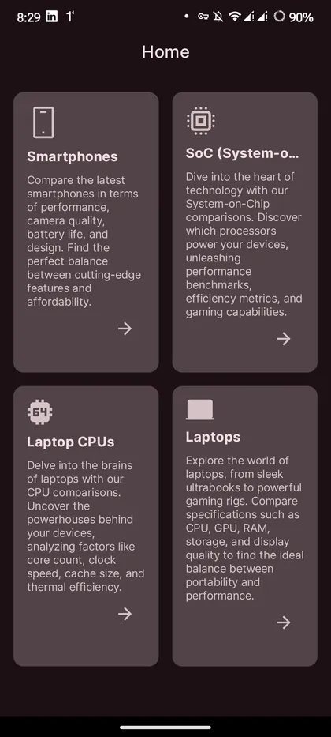
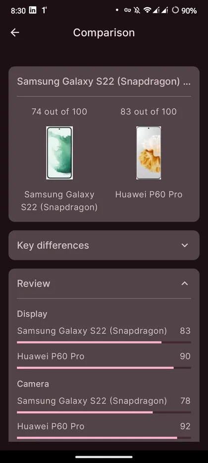

# Kyaw Zin Linn

**Software Engineer | Android & Kotlin Multiplatform**

I build Kotlin and Compose apps with a careful eye for architecture and UI, including apps that integrate NFC cards, POS terminals and RFID readers. Currently a Software Developer at SCITGoC (Singapore), working remotely from Da Nang, Vietnam.

[Portfolio](https://kyawzinlinn.vercel.app) · [Contact](#contact)

## About

- Building Android apps since 2020, from freelance Play Store apps to enterprise handheld-device software.
- Particular interests: modular architecture, offline-first data, and integrating hardware reliably.
- Currently building cross-platform apps with Compose Multiplatform and exploring newer Compose APIs, such as [shared element transitions](https://github.com/Kyawkk/Jetpack_Compose_New_APIs).

## Engineering focus

- **Native Android architecture.** Modular Compose apps with MVVM, Clean Architecture and Hilt, so features can grow without tangling the codebase.
- **Hardware integration.** Connecting apps to NFC cards, POS terminals, RFID readers and receipt printers on constrained handheld devices.
- **Payments and transactions.** Payment-gateway and card-tap flows, from charge to receipt.
- **Offline-first data.** Local caching with Room and background sync, so apps stay usable on unreliable networks.
- **Cross-platform with Compose Multiplatform.** One shared Compose UI across Android and iOS.

## Featured projects

### [Handheld POS and NFC bus ticketing](https://kyawzinlinn.vercel.app/work/handheld-pos-nfc-bus-ticketing)

Android point-of-sale app for bus fare collection on handheld terminals.

- **Highlights:** Coordinates NFC card reads, payment confirmation and thermal receipt printing as one sequential flow on Kotlin Coroutines, with an offline-first queue for poor connectivity.
- **Technology:** `Kotlin` · `Jetpack Compose` · `Coroutines` · `NFC (DESFire EV3)` · `GraphQL` · `ESC/POS`
- **Links:** [Case study](https://kyawzinlinn.vercel.app/work/handheld-pos-nfc-bus-ticketing) · Source is not public

### [Enterprise RFID and POS inventory](https://kyawzinlinn.vercel.app/work/enterprise-rfid-inventory)

Android app that connects handheld RFID readers to a cloud backend for asset tracking and point-of-sale.

- **Highlights:** Handles high-frequency tag reads without blocking the UI, using a buffered `SharedFlow` pipeline that sends batched updates to Compose. Includes payment-gateway processing and Supabase sync.
- **Technology:** `Kotlin` · `Jetpack Compose` · `SharedFlow` · `Zebra RFID SDK` · `Ktor` · `Supabase`
- **Links:** [Case study](https://kyawzinlinn.vercel.app/work/enterprise-rfid-inventory) · Source is not public

### [Forge: AI workout logger](https://kyawzinlinn.vercel.app/work/forge) (in development)

Workout logging app for Android and iOS that generates routines with AI and adapts them to logged sessions.

- **Highlights:** One shared Compose UI, multi-module Clean Architecture with MVI, AI plans streamed into the UI over Kotlin Flow, and offline-first drafts with background sync.
- **Technology:** `Compose Multiplatform` · `Kotlin` · `MVI` · `Ktor` · `Supabase`
- **Links:** [Case study](https://kyawzinlinn.vercel.app/work/forge) · Source is not public

### [Spec-Comparer](https://github.com/Kyawkk/Spec-Comparer)

Android app for comparing smartphones, SoCs, laptops and laptop CPUs side by side.

- **Highlights:** Feature modules (`home`, `search`, `details`, `compare`) built on shared core modules (`data`, `domain`, `model`, `network`, `design-system`, `components`). Specs are parsed with Jsoup; the repository states this is for educational use only.
- **Technology:** `Kotlin` · `Jetpack Compose` · `Hilt` · `Jsoup`
- **Links:** [Source](https://github.com/Kyawkk/Spec-Comparer) · [Release v1.0.0](https://github.com/Kyawkk/Spec-Comparer/releases/tag/v1.0.0)

  
  

### [Weather_App](https://github.com/Kyawkk/Weather_App)

Android weather app with hourly, daily and five-day forecasts and an offline cache.

- **Highlights:** Split into `core-*` modules (`data`, `database`, `network`, `navigation`, `design`, `ui`) and `feature-*` modules (`location`, `weather`).
- **Technology:** `Kotlin` · `Jetpack Compose` · `Hilt` · `Retrofit` · `Room` · `Coroutines`
- **Links:** [Source](https://github.com/Kyawkk/Weather_App)

**More:** [SMS_Sender](https://github.com/Kyawkk/SMS_Sender) (scheduled messages and auto-reply with WorkManager) · [MoviesApp](https://github.com/Kyawkk/MoviesApp) (offline-cached movie browser) · [Beer_App](https://github.com/Kyawkk/Beer_App) (Paging 3, offline-first)

## Technology stack

- **Languages and UI:** Kotlin, Kotlin Multiplatform, Java, Jetpack Compose, Compose Multiplatform
- **Architecture:** MVVM, MVI, Clean Architecture, multi-module Gradle projects, Hilt
- **Data and networking:** Coroutines and Flow, Room, Retrofit, Ktor, GraphQL, Supabase, Firebase, WorkManager, Paging 3
- **Devices:** NFC (DESFire EV3), POS terminal SDKs, Zebra RFID SDK, ESC/POS receipt printing
- **Tooling:** Android Studio, Git

## Contact

- Portfolio: [kyawzinlinn.vercel.app](https://kyawzinlinn.vercel.app)
- GitHub: [repositories](https://github.com/Kyawkk?tab=repositories)
- Email: [kzin5717@gmail.com](mailto:kzin5717@gmail.com?subject=Hello%20from%20GitHub)
