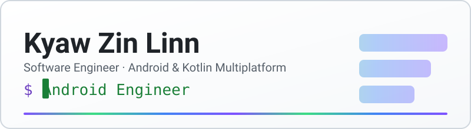

<picture>
  <source media="(prefers-color-scheme: dark)" srcset=".github/assets/banner-dark.svg">
  <source media="(prefers-color-scheme: light)" srcset=".github/assets/banner-light.svg">
  
</picture>

**Software Engineer | Android & Kotlin Multiplatform**

I build Kotlin and Compose apps with a careful eye for architecture and UI, including apps that integrate NFC cards, POS terminals and RFID readers.
 Software Developer at SCITGoC (Singapore) · working remotely from Da Nang, Vietnam

  

## 👋 About

- 🛠️ Building Android apps since 2020, from freelance Play Store apps to enterprise handheld-device software.
- 🧩 Particular interests: modular architecture, offline-first data, and integrating hardware reliably.
- 🔭 Currently building cross-platform apps with Compose Multiplatform and exploring newer Compose APIs, such as [shared element transitions](https://github.com/Kyawkk/Jetpack_Compose_New_APIs).

## 🧭 Engineering focus

- 🏗️ **Native Android architecture.** Modular Compose apps with MVVM, Clean Architecture and Hilt, so features can grow without tangling the codebase.
- 📡 **Hardware integration.** Connecting apps to NFC cards, POS terminals, RFID readers and receipt printers on constrained handheld devices.
- 💳 **Payments and transactions.** Payment-gateway and card-tap flows, from charge to receipt.
- 📶 **Offline-first data.** Local caching with Room and background sync, so apps stay usable on unreliable networks.
- 🌐 **Cross-platform with Compose Multiplatform.** One shared Compose UI across Android and iOS.

## 🚀 Featured projects

### [Handheld POS and NFC bus ticketing](https://kyawzinlinn.vercel.app/work/handheld-pos-nfc-bus-ticketing)

Android point-of-sale app for bus fare collection on handheld terminals.

- **Highlights:** Coordinates NFC card reads, payment confirmation and thermal receipt printing as one sequential flow on Kotlin Coroutines, with an offline-first queue for poor connectivity.
- **Links:** [Case study](https://kyawzinlinn.vercel.app/work/handheld-pos-nfc-bus-ticketing)

      

### [Enterprise RFID and POS inventory](https://kyawzinlinn.vercel.app/work/enterprise-rfid-inventory)

Android app that connects handheld RFID readers to a cloud backend for asset tracking and point-of-sale.

- **Highlights:** Handles high-frequency tag reads without blocking the UI, using a buffered `SharedFlow` pipeline that sends batched updates to Compose. Includes payment-gateway processing and Supabase sync.
- **Links:** [Case study](https://kyawzinlinn.vercel.app/work/enterprise-rfid-inventory)

      

### [Forge: AI workout logger](https://kyawzinlinn.vercel.app/work/forge)

Workout logging app for Android and iOS that generates routines with AI and adapts them to logged sessions.

- **Highlights:** One shared Compose UI, multi-module Clean Architecture with MVI, AI plans streamed into the UI over Kotlin Flow, and offline-first drafts with background sync.
- **Links:** [Case study](https://kyawzinlinn.vercel.app/work/forge)

      

### [Spec-Comparer](https://github.com/Kyawkk/Spec-Comparer)

Android app for comparing smartphones, SoCs, laptops and laptop CPUs side by side.

- **Highlights:** Feature modules (`home`, `search`, `details`, `compare`) built on shared core modules (`data`, `domain`, `model`, `network`, `design-system`, `components`). Specs are parsed with Jsoup; the repository states this is for educational use only.
- **Links:** [Source](https://github.com/Kyawkk/Spec-Comparer) · [Release v1.0.0](https://github.com/Kyawkk/Spec-Comparer/releases/tag/v1.0.0)

    

  
  

### [Weather_App](https://github.com/Kyawkk/Weather_App)

Android weather app with hourly, daily and five-day forecasts and an offline cache.

- **Highlights:** Split into `core-*` modules (`data`, `database`, `network`, `navigation`, `design`, `ui`) and `feature-*` modules (`location`, `weather`).
- **Links:** [Source](https://github.com/Kyawkk/Weather_App)

     

**More:** [SMS_Sender](https://github.com/Kyawkk/SMS_Sender) (scheduled messages and auto-reply with WorkManager) · [MoviesApp](https://github.com/Kyawkk/MoviesApp) (offline-cached movie browser) · [Beer_App](https://github.com/Kyawkk/Beer_App) (Paging 3, offline-first)

## 🧰 Tech stack

**Languages and UI** 
    

**Architecture** 
    

**Data and networking** 
        

**Devices** 
   

**Tooling** 
  

## 📊 GitHub activity

<picture>
  <source media="(prefers-color-scheme: dark)" srcset="https://github-profile-summary-cards.vercel.app/api/cards/profile-details?username=Kyawkk&theme=github_dark">
  <source media="(prefers-color-scheme: light)" srcset="https://github-profile-summary-cards.vercel.app/api/cards/profile-details?username=Kyawkk&theme=github">
  
</picture>

<picture>
  <source media="(prefers-color-scheme: dark)" srcset="https://github-profile-summary-cards.vercel.app/api/cards/most-commit-language?username=Kyawkk&theme=github_dark">
  <source media="(prefers-color-scheme: light)" srcset="https://github-profile-summary-cards.vercel.app/api/cards/most-commit-language?username=Kyawkk&theme=github">
  
</picture>

## 💼 Career

- **2024 – present** · Software Developer, SCITGoC (Singapore)
- **2023 – 2024** · Android Developer, E-Tag RFID (Singapore)
- **2022 – 2023** · Android Developer, Light Idea Software Company (Myanmar)
- **2020 – 2022** · Freelance Android Developer (remote)

## 📬 Connect

  

<picture>
  
</picture>

